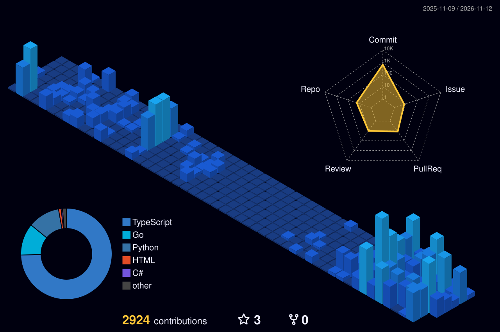

# Teguh Dwi Cahya Kusuma

**Backend &amp; platform engineer** — Go · TypeScript · Python

I build the parts users never see and always feel: APIs, data models, gateways,
and the deployment plumbing that keeps a demo alive in production.

Yogyakarta, Indonesia &nbsp;·&nbsp; <a href="https://diama.dev">diama.dev</a> &nbsp;·&nbsp; <a href="mailto:teguh.dc.kusuma@gmail.com">teguh.dc.kusuma@gmail.com</a>

---

## Stats, rendered by this repository

A workflow regenerates these files on a schedule, so nothing here depends on a
third-party card server staying up.

  

## Activity, refreshed while you read

Updated by <code>github-activity-readme</code> every 6 hours

<!--START_SECTION:activity-->
<!--END_SECTION:activity-->

## Fun

  

